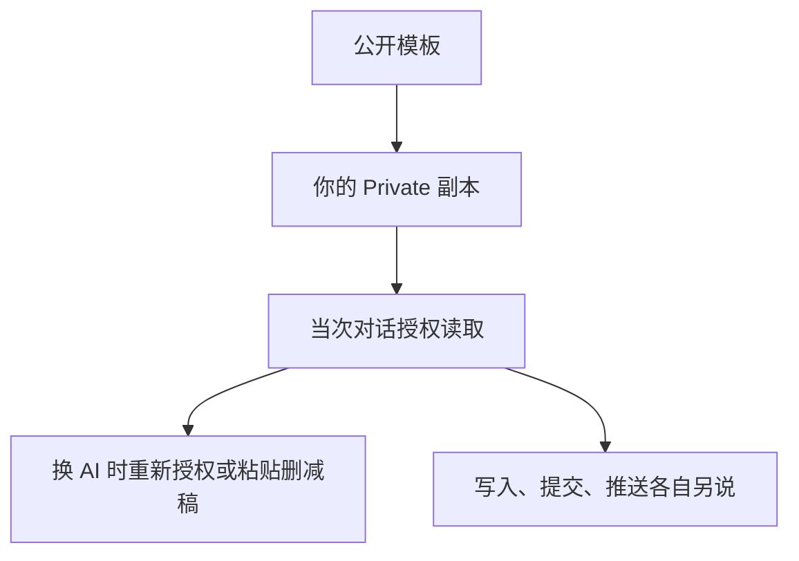

中文 · [English](README_EN.md)

# 跨 AI 个人档案模板

用你自己的 **Private** GitHub 仓库保存一份 Markdown 背景。Git 负责版本，内容不绑定某一家模型。换工具时，在当次对话里用可复制提示词授权读取，对方才能复用同一份背景。要改档案，另一次明确授权。

本仓库是公开模板：[sololeveling-a11y/ai-profile-template](https://github.com/sololeveling-a11y/ai-profile-template)。这里只保留说明、空模板和标明虚构的示例。填好的内容只放在你新建的 `<your-username>/<your-private-repo>`。个人内容不要推回这个公开仓库。

适合希望自己掌握长期背景、并在多种 AI 工具之间换用的人。你需要一个 GitHub 账号，不需要先写程序。本仓库没有脚本，也没有 GitHub Actions。档案可以一直很短。短、并且标清层级，比把整段聊天记录放进来更不容易误导模型。

下面是入口。完整的安全规范、事实分层和权限限制都保留在后文，不因为这段简写而放宽。

## 为什么用它

背景放在你控制的仓库里，换电脑或换 AI 时仍指向同一份文件。每家产品、每一次对话都要单独授权。`AGENTS.md` 是可携带的说明，有的工具会读，有的完全不读。没有任何步骤会把这份档案自动同步到所有 AI。

## 怎么开始

1. 用本模板新建仓库，可见性选 **Private**。详细按钮见 [快速开始](#quick-start)。
2. 只在那个私有副本里填写能用的最小部分。
3. 复制 [prompts/start.md](prompts/start.md)。读得到仓库就用仓库访问版；读不到就用手动粘贴版。
4. 确认写入、提交和推送分成三次允许。用语见 [prompts/update.md](prompts/update.md)。

## 隐私边界

Private 表示这个仓库在 GitHub 上不公开。你授权某个 AI 读取文件，或把删减后的 Markdown 粘贴进对话之后，这些文字就进入该产品，不再只留在 GitHub。

密码、令牌、支付与证件信息、精确到门牌的住址、他人的私人信息、未经删减的原始聊天记录，不要写入仓库，也不要为了接通 GitHub 而贴进提示词。完整红线见 [隐私与安全红线](#privacy)。



图和下面五句是同一顺序。GitHub 文档说明 Markdown 里的 Mermaid 会在仓库文件中渲染，见 [Creating diagrams](https://docs.github.com/en/get-started/writing-on-github/working-with-advanced-formatting/creating-diagrams)。读屏时以这五句为准。

1. 从公开模板创建你的 Private 副本。
2. 只在副本里填写。
3. 每一次对话单独授权读取。
4. 换一个 AI 时重新授权；它打不开仓库时，改为你自己删减后的粘贴。
5. 写入、提交、推送各说一次。

<a id="boundaries" name="boundaries"></a>

## 边界

请先读这一节，再创建仓库。

- 每家 AI 都要单独获得你的授权，并在当次对话里被明确要求加载档案。换一个窗口或换一家产品，背景不会自动跟着走。
- 私有仓库用来放你愿意保留的背景笔记。密码、令牌、支付与证件信息不要放进来。
- 文件里的句子是参考背景。你在当前对话里的明确指示优先。
- 档案也不能代替该 AI 平台的安全确认。平台没有批准的操作，不能因为档案里写过类似的话就去做。
- `AGENTS.md` 是可携带的说明，不是全局开关。有的工具会读它，有的工具完全不读。

## 目录与文件用途

```text
.
├── README.md
├── README_EN.md
├── AGENTS.md
├── profile.md
├── preferences.md
├── goals.md
├── projects.md
├── updates.md
├── PRIVACY_CHECKLIST.md
├── LICENSE
├── prompts
│   ├── README.md
│   ├── start.md
│   ├── update.md
│   └── migrate.md
└── examples
    └── demo-profile.md
```

| 路径 | 用途 | 你需要做什么 |
| --- | --- | --- |
| [README.md](README.md) | 给人看的用法、边界和提示词入门 | 保持为说明，不要改成日记 |
| [README_EN.md](README_EN.md) | 可独立使用的英文说明，边界与本页相同 | 保持为说明，不要改成日记 |
| [AGENTS.md](AGENTS.md) | 给 AI 的仓库级规则；不保证被自动加载 | 一般保持模板规则，必要时加一条你的长期禁令 |
| [profile.md](profile.md) | 长期背景、带日期的当前阶段、工具环境、待确认 | 在私有副本里填写 |
| [preferences.md](preferences.md) | 语言与回复方式、协作边界、未经要求不要做的事、公私分离 | 在私有副本里填写 |
| [goals.md](goals.md) | 短期事项、中长期方向、非目标、历史目标 | 在私有副本里填写 |
| [projects.md](projects.md) | 已完成、进行中、未开始，避免把想法说成成果 | 在私有副本里填写 |
| [updates.md](updates.md) | 带日期、时区、来源、摘要的变更记录；区分现行规则与历史决定 | 确认事实后再追加 |
| [prompts/](prompts/README.md) | 可复制的完整提示词 | 使用时复制，并替换仓库占位符 |
| [PRIVACY_CHECKLIST.md](PRIVACY_CHECKLIST.md) | 可见性、Pages、协作者、秘密与身份边界 | 提交前和定期复查时逐项看过 |
| [examples/demo-profile.md](examples/demo-profile.md) | 虚构示例，演示密度和日期写法 | 不要当成你的事实；私有副本里可以删掉整个 `examples/` |
| [LICENSE](LICENSE) | MIT 许可 | 保留版权声明 |

<a id="quick-start" name="quick-start"></a>

## 快速开始

如果你已经在自己的私有副本里，从第 2 步开始。

### 1. 用模板新建仓库，并选择 Private

1. 打开 [sololeveling-a11y/ai-profile-template](https://github.com/sololeveling-a11y/ai-profile-template)。
2. 点击 **Use this template**，选择 **Create a new repository**。界面是中文时，选择等价的“使用此模板”，再创建新仓库。按钮说明见 GitHub 文档 [Creating a repository from a template](https://docs.github.com/en/repositories/creating-and-managing-repositories/creating-a-repository-from-a-template)。
3. 填写仓库名。可见性选择 **Private**。不要选 Public。若页面不允许 Private，先停下，检查账号或组织策略，不要先建成 Public。
4. 本模板只有默认分支，分支选项保持默认即可。
5. 创建后确认地址属于你的账号，形式为 `https://github.com/<your-username>/<your-private-repo>`，并且页面标为 Private。可见性以后可在 Settings 里复查，见 [Setting repository visibility](https://docs.github.com/en/repositories/managing-your-repositorys-settings-and-features/managing-repository-settings/setting-repository-visibility)。
6. 不要开启 GitHub Pages，不要添加你不认识的协作者。私有副本不必再标记为 Template repository。

个人内容不要推回这个公开模板。

### 2. 先填能用的最小部分

五到十分钟够用。先写下面这些，其余以后补。空着并写“未记录”，好过写进一项你还没核实的经历。

1. [profile.md](profile.md) 的背景：两三句非敏感的长期事实。
2. [profile.md](profile.md) 的当前阶段：日期、时区、一句话。时区用 IANA 名称，例如 `Asia/Shanghai`，按你自己的时区替换，然后全库一致。
3. [preferences.md](preferences.md)：回复语言，以及一件未经要求就不要做的事。
4. [goals.md](goals.md)：一件短期事项，一件非目标。
5. [projects.md](projects.md)：进行中和未开始若有就各写一条，状态不要填错。没有就留着占位，并理解为尚未填写。

格式密度可以对照 [examples/demo-profile.md](examples/demo-profile.md)。那个文件顶部已标明全部虚构，不要把里面的人物复制进你的档案。

至少把 [profile.md](profile.md) 里的档案仓库一行，改成你的 `<your-username>/<your-private-repo>`。

### 3. 复制提示词，让 AI 读取或更新

打开 [prompts/README.md](prompts/README.md) 选择一份。第一次对话用 [prompts/start.md](prompts/start.md)。要写入时用 [prompts/update.md](prompts/update.md)。从旧工具搬迁时用 [prompts/migrate.md](prompts/migrate.md)。

复制前把提示词里的 `<your-username>/<your-private-repo>` 换成你的私有仓库，也就是 `<你的GitHub用户名>/<你的私有档案仓库名>`。不要在提示词或 Git 地址里加入令牌。

### 4. 之后保持短而可核对

- 一件事有了新结论时，追加 [updates.md](updates.md)，并把旧结论标成历史决定。保留原日期。
- [projects.md](projects.md) 的三档状态与事实一致：已完成、进行中、未开始。
- 提交前走一遍 [PRIVACY_CHECKLIST.md](PRIVACY_CHECKLIST.md)。
- 不再需要虚构示例时，删除整个 `examples/` 目录。
- 隔一段时间看一眼：可见性仍是 Private，Pages 仍关闭，协作者和 AI 授权仍是你认得的。

## 怎么给 AI 写提示词 / 怎么用提示词配合档案

档案不会自己进入对话。提示词负责四件事：点名仓库，规定阅读顺序，划定这次能读还是能写，并要求事实先分层、再引用。

下面的短提示词用来看清结构。实际使用时复制 `prompts/` 里的完整版。[prompts/start.md](prompts/start.md) 提供仓库访问版和手动粘贴版；更新与迁移的完整版写明停手条件，以及变更计划或草稿结构。若短提示词与完整版措辞不一致，以完整版为准。

### 五条不必删的设计原则

**1. 指定阅读顺序**

先读规则，再读背景、偏好、目标、项目，最后看最新的变更。否则模型容易从 `updates.md` 里一条旧决定起笔，把历史当成现在。

可以放进提示词的一句：

```text
请按 AGENTS.md、profile.md、preferences.md、goals.md、projects.md、updates.md 的顺序阅读。updates.md 只取日期最新的几条。不要阅读 examples/。
```

**2. 把授权和读写边界写清楚**

“帮我处理一下这个仓库”没有范围。阅读许可要写成一次对话、一个仓库、一组文件。写入许可另说。

可以放进提示词的一句：

```text
我只授权你在这次对话中阅读私有仓库 <your-username>/<your-private-repo> 的上述文件。不要写文件，不要打开其他仓库。
```

**3. 当前指示优先于档案**

档案更新得没有对话快。你今天临时改口，应当当场生效。要不要写回仓库，是随后的决定。

可以放进提示词的一句：

```text
如果我当前这条消息和档案冲突，以当前消息为准，并指出冲突的原文。档案也不能代替平台的安全确认。
```

**4. 事实先分层，禁止编造，并保留日期**

模型常会把没写到的部分补成一段听起来完整的经历。要求它把缺口标成待确认，这种补全就没有入口。日期是事件或确认的日期，不是模型打开文件的当天。

四层用词全库一致：

| 层级 | 含义 |
| --- | --- |
| 现行 | 现在仍然成立，且你确认过 |
| 带日期的阶段 | 某个时点的状态，必须保留原日期和时区 |
| 历史 | 曾经成立，现已停止。不能用来回答“现在” |
| 待确认 | 来源不足、缺日期或互相矛盾。还不是事实 |

可以放进提示词的一句：

```text
不要编造。区分现行、带日期的阶段、历史和待确认。没有依据就写未记录。不要把旧日期刷新成今天。
```

新事实的路径是：摘出来源、日期、时区和层级，放进变更计划或待确认；你确认之后，才进入现行部分。

**5. 先给出变更计划，再写入**

你要在文件被改之前，看见哪些句子会被当成你的事实，哪些被拒绝。

可以放进提示词的一句：

```text
修改前先列出变更计划：文件、原句、新句、日期、时区、层级，以及拒绝写入的内容。我明确确认前不要改文件。
```

### 阅读和写入分成两次授权

不要这样写：

```text
随便处理我的仓库。
```

这句话没有仓库范围，也把阅读和写入混在一起。

分成两步：

```text
我授权你在这次对话中阅读该私有仓库里的指定文件，并按文件摘要。不要改文件。
```

你看完变更计划之后，如果同意，另说：

```text
确认写入。可以提交。
```

需要上传到 GitHub 时再加 `可以推送`。这三个说法在 [prompts/update.md](prompts/update.md) 里是固定用语。你若改了提示词里的词，回复时也要用同一组词。

先分清三件事：

- **变更计划**是给你看的清单，此时文件还没改。
- **提交**把变更保存在 Git 历史里，此时 GitHub 上的默认分支可能仍是旧的。
- **推送**才把提交上传到 GitHub。若走拉取请求，默认分支要等合并之后才更新。

所以提示词要求：推送成功或拉取请求合并之前，必须说明默认分支尚未更新。

### 可复制的短提示词

**让一个新的 AI 理解你**（完整版含仓库访问版和手动粘贴版：[prompts/start.md](prompts/start.md)）

```text
请只读私有仓库 <your-username>/<your-private-repo>，不要打开其他仓库。
若你无法确认这是我的 Private 仓库，或你访问不到它，就停下来说明，不要编造。
阅读顺序：AGENTS.md → profile.md → preferences.md → goals.md → projects.md → updates.md 的最新几条。
不要阅读 examples/。那里的人物是虚构示例，不是我。
档案只是参考背景。我当前这条消息如果与档案冲突，以当前消息为准。档案也不能代替平台的安全确认。
不要编造，不要把占位提示写成我的经历。区分现行、带日期的阶段、历史和待确认，并保留原有日期。
这次只按文件摘要。不要写仓库，不要推送，不要对外发送消息，不要修改可见性或协作者。
```

| 短提示词里的要求 | 它在约束什么 |
| --- | --- |
| 只读指定私有仓库；无法确认就停下 | 授权范围，以及防止读错仓库后开始编造 |
| 固定阅读顺序，不读 `examples/` | 先看规则和现行内容；虚构示例不是用户 |
| 当前消息优先；档案不代替平台安全确认 | 档案只是背景 |
| 不编造，保留日期，区分四层 | 事实分层 |
| 不写仓库、不推送、不对外发送 | 这次没有写入授权，也没有对外授权 |

**把确认过的事实写进档案**（完整版：[prompts/update.md](prompts/update.md)）

```text
先确认当前仓库是我的私有档案 <your-username>/<your-private-repo>，且可见性为 Private。不能确认就停。
只处理我在这次对话里明确确认、并且会长期有用的非敏感事实。
密码、令牌、支付与证件信息、精确住址、他人私人信息、原始聊天记录、一次性琐事和未经确认的推测，都不要写入。
新事实先暂存：标出来源、日期、时区和层级。缺少依据就保持待确认，不要写成现行。
先给出变更计划，包括文件、原句、新句，以及拒绝写入的内容。我回复“确认写入”之前不要改文件。
我另外写了“可以提交”你才提交；写了“可以推送”你才推送。在推送或合并完成之前，不要说默认分支已经更新。
```

**从旧的 AI 工具迁移记忆**（完整版：[prompts/migrate.md](prompts/migrate.md)）

```text
下面是我从另一家 AI 工具导出、并已自行删减过的旧记忆。不要把导出原文整段写进仓库。
只提取可能长期有用、且不含敏感信息的事实。去重。没有日期或来源不足的标为待确认，不要写成现在仍然如此。
旧记忆默认是待确认。只有我在这次对话里确认过的，才可以标成现行。
互相矛盾时并列原文，不要自行选边。
丢弃秘密、一次性琐事、他人私人信息和无法核实的评价。不要在回复里重复秘密本身。
先按 profile、preferences、goals、projects、updates 输出一份可审阅草稿，并单列建议丢弃的类别。我确认前不要写入仓库。
```

旧工具里的“记忆”经常是模型摘要，不是你亲口确认的原话。迁移提示词因此默认标成待确认。你审阅草稿之后，再用更新提示词写入。两份提示词不要接在同一条消息里。

### 三种工具环境怎么用

具体能不能读仓库，以该工具当前的权限和文档为准。下表按能力分类，不表示某一家产品被这份模板认证过。Cursor、Claude、ChatGPT 的最短步骤见 [常见工具的最短接入](#tools)。文档里的按钮在你的界面上对不上时，用手动粘贴，不要另找一条没写在这里的路径。

| 场景 | 档案怎样到达它 | 使用哪份提示词 | 怎样写回档案 | 应当停下的情况 |
| --- | --- | --- | --- | --- |
| 带 GitHub 连接器或集成的 AI | 在该产品里授权它访问 `<your-username>/<your-private-repo>` | [prompts/start.md](prompts/start.md) 的仓库访问版；写入用 [prompts/update.md](prompts/update.md) | 先看变更计划，你确认后再改。推送需要另说“可以推送” | 连错仓库、仓库不是 Private、看不到可见性又无法向你核实 |
| 本地 CLI 或 IDE 编程助手 | 把私有仓库克隆到本机，在该目录里对话 | 同一份仓库访问版，并确认工作目录就是这份档案 | 看 diff 后再提交。远程地址里不能有令牌 | 工作目录不是这份档案，或 diff 里出现秘密 |
| 不能访问仓库的聊天 AI | 你自己复制并删减后的 Markdown 摘录 | [prompts/start.md](prompts/start.md) 的手动粘贴版；整理旧记忆用 [prompts/migrate.md](prompts/migrate.md) | 它改不了你的仓库。你把审阅后的句子贴回文件，或换一个能写仓库的工具执行更新提示词 | 敏感句还没删掉时，不要粘贴 |

三种方式可以先后使用，例如在网页聊天里做迁移草稿，再在本地仓库里按更新提示词写入。同一时刻只让一个工具改这些文件。

不能访问仓库时的复制范围：四个核心文件，加上 `updates.md` 的最新几条。不要复制 `examples/`。粘贴前在本地再看一遍。提示词要求对方不要复述秘密，但不能保证该产品的对话记录里没有你粘贴过的文字。

授权用各产品自己的登录或连接器完成。不要把令牌写进提示词，来换取仓库访问。

### 写完一条提示词后检查一次

- 仓库名已经替换，并且是你的私有副本。
- 读和写分成了两句授权。
- 要求了保留日期，并禁止编造。
- 这次如果会改文件，要求了先看见变更计划。
- 提示词和 Git 地址里都没有令牌。

后续消息要指出上一条的具体问题，并缩小范围。不要在每条后续消息里重新给予推送许可。更多可复制的后续短句见 [prompts/README.md](prompts/README.md)。

<a id="tools" name="tools"></a>

## 常见工具的最短接入

这一节摘自 2026-11-25 仍能打开的厂商文档，用来选一条最短路径。本模板没有在 Cursor、Claude 或 ChatGPT 里执行这些步骤，也不构成认证。套餐、地区和界面不同，入口可能不存在。对不上就停，改用手动粘贴。

读取和更新是两次授权。下面的步骤只把背景送进这一次对话。写入、提交、推送仍要另说“确认写入”“可以提交”“可以推送”。

### 手动粘贴：读不到仓库时用这条

任何产品都可以用这条，包括上面三家的入口不存在、私有仓库授不了权、或你不想把仓库连接给该产品的时候。

1. 在你自己的电脑上打开私有副本，复制 [profile.md](profile.md)、[preferences.md](preferences.md)、[goals.md](goals.md)、[projects.md](projects.md)，以及 [updates.md](updates.md) 里最新的几条。
2. 粘贴前删掉秘密、支付与证件信息、精确住址、他人私人信息和整段原始聊天记录。提示词要求对方不要复述秘密，但不能把已经粘贴出去的文字从对方的对话记录里收回。
3. 不要复制 [examples/demo-profile.md](examples/demo-profile.md)。
4. 使用 [prompts/start.md](prompts/start.md) 的手动粘贴版。不要向对方索取或提供令牌，也不要让它“自己去连 GitHub”。

### Cursor：打开本地副本

最短的读取方式是让 Cursor 看见你已经克隆的文件夹，而不是去接 Cloud Agent。

1. 克隆你的私有副本。远程地址只用 `git@github.com:<your-username>/<your-private-repo>.git` 或 `https://github.com/<your-username>/<your-private-repo>.git`。
2. 用 Cursor 打开这个仓库目录。文档把根目录的 `AGENTS.md` 当作 Agent 指令，并写明规则不影响 Cursor Tab。同一页写明：规则里点名的文件不会被原文塞进提示词，Agent 在需要时再用工具去读，编辑器、CLI 和 Cloud Agents 都是这样：[Rules](https://cursor.com/docs/rules)。因此打开目录不等于 `profile.md` 已经进入这次对话，也不等于同步到其他产品。
3. 在 Agent 对话里粘贴 [prompts/start.md](prompts/start.md) 的仓库访问版，把占位符换成你的私有仓库。这一次只读。
4. 对方若不能确认该仓库是 Private，或读不到文件，就停，改用手动粘贴版。你让它读到的文字会进入这次请求的模型上下文，不再只留在 GitHub。保留多久以 Cursor 当时的隐私设置为准，本页不代替那份政策。

不要把 [Cloud Agents](https://cursor.com/docs/cloud-agent) 当作只读捷径。该文档写明 Cloud Agent 会克隆仓库、在另一条分支上工作并推送，并且需要该仓库的读写权限。桌面版文档中的启动方式，是在 Agent 输入框下方的下拉菜单里选择 Cloud。同一页的排错说明写明 Free 与 Plus 不包含 Cloud Agents。读这份档案时不要选 Cloud。GitHub 集成文档写的是 Cloud Agents 与 Bugbot 的连接，设置步骤要求 Cursor 管理员和 GitHub 组织管理员，排错条目包含私有仓库权限：[GitHub](https://cursor.com/docs/integrations/github)。个人账号若看不到文档里的 Dashboard，不要猜测按钮。本模板也不要求你创建名为 `GH_TOKEN` 的个人访问令牌。

### Claude：文档中的 GitHub 入口对得上才用

帮助中心 [Use the GitHub integration](https://support.claude.com/en/articles/10167454-use-the-github-integration) 的页面日期是 October 20, 2026。它写的入口是：聊天界面左下角 “+”，选择 “Add from GitHub”；或在 Project knowledge 右上角 “+”，选择 “GitHub”，再在文件浏览器里挑选文件。你的屏幕上没有这些字样时，不要改用别的菜单，直接手动粘贴。

对得上时：

1. 只选择私有副本里的档案文件：`AGENTS.md`、`profile.md`、`preferences.md`、`goals.md`、`projects.md`，以及需要的 `updates.md`。不要为了省事授权全部仓库。
2. 私有仓库要在 Claude 的 GitHub App 里授予该仓库。授不了就停。不要粘贴令牌，也不要把仓库地址贴进这个公开模板。
3. 该页写明取回的是某个分支上的文件名和内容，不含提交历史、PR 或其他元数据。Project 里的 “Sync” 或 “Sync now” 是在 Claude 里手动刷新已经选过的文件，不是自动同步到 Cursor 或 ChatGPT，也不是实时镜像。
4. 选中的文件内容由 Claude 处理，因此离开 GitHub。同一页写明：失去仓库访问之后，已发生的对话历史仍会保留。
5. 再粘贴 [prompts/start.md](prompts/start.md) 的仓库访问版。这次授权是读取。该帮助页没有把“加上 GitHub 文件”定义成可以修改你的 GitHub 仓库。

### ChatGPT：文档中的 GitHub 连接对得上才用

OpenAI 帮助中心 [Connecting GitHub to ChatGPT](https://help.openai.com/en/articles/11145903-connecting-github-to-chatgpt) 在 2026-11-25 写的路径是：Settings > Plugins，选择 GitHub 或包含它的插件，然后到 GitHub 安装应用并选择仓库。屏幕上不是 “Plugins” 时，不要改猜下一级菜单，直接手动粘贴。

该页同时写明这几件限制：

- 连接后按需取回已授权仓库里的内容，包含代码、README 和其他文档。它不建立一份同步索引，也没有按仓库单独配置的索引。
- 能否在标准聊天、deep research 或 agent 里使用，取决于套餐、工作区和界面。标准聊天里看不到时，不要假定另一个模式一定有。
- 私有或新建仓库要等 ChatGPT 的 GitHub 应用装到正确的账号或组织，并且该仓库已被选中并批准。组织可能还要管理员批准。
- FAQ 写明：ChatGPT 里的这个 GitHub 应用只用于读取、分析和搜索。要生成、修改并直接推送到 GitHub，文档指向 Codex。本模板不提供 Codex 的写入步骤。
- 检索时，ChatGPT 会根据你的问题生成查询并发给 GitHub。取回的内容进入 ChatGPT。商业版默认不用于改进模型；个人账号则取决于 “Improve the model for everyone” 一类设置。以该页 “Data and privacy” 为准。

仓库确实出现在已授权列表之后，粘贴 [prompts/start.md](prompts/start.md) 的仓库访问版，并写明只读哪一个 `<your-username>/<your-private-repo>`。连接 GitHub 不等于可以提交或推送。

<a id="privacy" name="privacy"></a>

## 隐私与安全红线

下列内容不要出现在私有档案的文件、提交说明、issue 或远程地址里：

- 密码、令牌、API 密钥、私钥、cookie、会话标识
- 支付信息、银行卡号、证件号码
- 精确到门牌的住址
- 他人的私人信息
- 未经删减的原始聊天记录

远程地址使用 `git@github.com:<your-username>/<your-private-repo>.git` 或 `https://github.com/<your-username>/<your-private-repo>.git`。不要使用在 `https://` 后面、`github.com` 前面夹入令牌的形式。

不要把私有档案改成 Public。不要开启 GitHub Pages。公开模板只负责空白说明；填写结果留在你的私有仓库。

能唯一识别你或他人、且你不希望被复制到其他工具的细节，也先不要写。

秘密如果已经进入 Git 历史，只在最新文件里删掉一行并不能消除旧副本。停止继续推送，作废该凭据，并按 [PRIVACY_CHECKLIST.md](PRIVACY_CHECKLIST.md) 里的链接处理历史。不要把秘密再贴到聊天或 issue 里来说明问题。

## 常见问题

### `AGENTS.md` 会在所有 AI 里自动生效吗？

不会。有的编程助手会在仓库里发现 [AGENTS.md](AGENTS.md)，有的产品完全不读它。就算某个工具今天会读，换一个工具或关掉权限之后也不会继承。需要它在这一次对话里生效时，用 [prompts/start.md](prompts/start.md) 把阅读顺序和边界再写一遍。

### 可以和公开简历或作品集放在同一个仓库吗？

不要放在一起。公开仓库给人浏览，私有档案给你授权过的 AI 当作背景。用本模板新建仓库时选择 Private，与公开作品集分开。公开页面只放你愿意给陌生人看的内容。AI 只有在你当前消息里逐段指定时，才可以把某一句改写进公开仓库。两边内容可以多少不同：公开版本更短是正常的。

### 档案互相冲突，或某条已经过时，怎么办？

让 AI 停下，并列引用冲突的原文、文件名和日期，由你指定以哪一条为准。过时的内容改标为历史决定，写上停止生效的日期，保留在 [updates.md](updates.md) 或对应文件的历史小节里。不要不留日期地覆盖。没有依据的句子改回“未记录”或“待确认”。

当前对话里的新指示优先于旧文件。你若希望新指示长期有效，再用更新提示词把它写回去。

### 还没填完，可以先让 AI 读吗？

可以。它应当告诉你哪些仍是占位，而不是把【】里的说明写成你的经历。

### 对话里的每句话都要进档案吗？

不要。只留长期、非敏感、你确认过的事实。其余留在那次对话里即可。

### 我授权它读仓库之后，它能不能自己发消息或改仓库设置？

不能。档案是背景，不是新的授权。发送外部消息、修改可见性、增减协作者、开启 Pages、推送到默认分支，都要你在当前对话里另作确认。完整边界写在 [AGENTS.md](AGENTS.md)。

## 向这个公开模板提改进

改进说明、空模板、提示词和虚构示例时，不要加入真实个人档案。示例人物必须在文件顶部标明虚构。不要添加脚本或 GitHub Actions。

## 许可

本仓库的说明、空模板和提示词以 MIT 许可发布，见 [LICENSE](LICENSE)。版权声明为 `Copyright (c) 2026 sololeveling-a11y`。

你在私有副本里写下的个人内容由你自己负责。使用模板不会把那些内容变成公开模板的一部分。不要把填好的档案推送到这个公开仓库。
