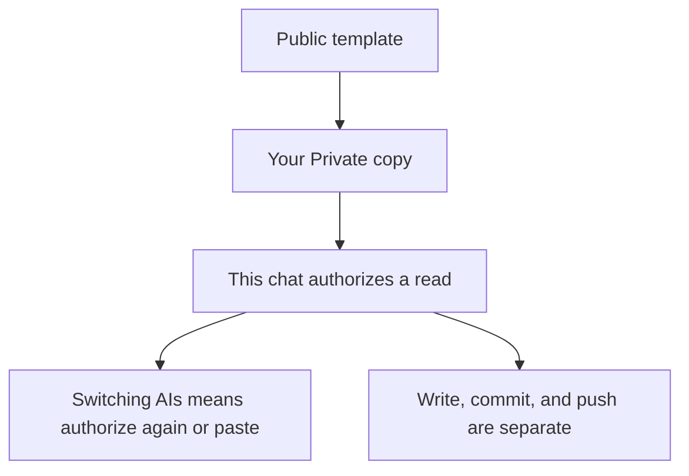

[中文](README.md) · English

# A private archive you reuse across AI tools

Keep long-term background in a **Private** GitHub repository of Markdown that you own. Git stores the versions. The files are not tied to one model. When you change tools, a copyable prompt authorizes that conversation to read the same files. Changing the archive takes a separate explicit authorization.

This repository is the public template: [sololeveling-a11y/ai-profile-template](https://github.com/sololeveling-a11y/ai-profile-template). It keeps instructions, blank templates, and a sample marked as fiction. Filled-in text belongs only in the private repository you create, `<your-username>/<your-private-repo>`. Do not push personal text back to this public repository.

You need a GitHub account. You do not need to write a program first. This repository has no scripts and no GitHub Actions. The archive can stay short. A short entry with a clear layer misleads a model less than a pasted chat log.

The opening below is the entrance. The safety rules, fact layers, and permission limits later in this file stay in force.

## Why it exists

The background lives in a repository you control, so another computer or another AI can be pointed at the same files. Each product and each conversation needs its own authorization. `AGENTS.md` is a portable instruction file: some tools read it, and some never do. Nothing in this template syncs the archive to every AI automatically.

## How to start

1. Create a new repository from this template and set the visibility to **Private**. The button names are in [Quick start](#quick-start).
2. Fill only the smallest useful part, and fill it in that private copy.
3. Copy [prompts/start.md](prompts/start.md). Use the repository-access version when the tool can read the repository. Use the manual-paste version when it cannot.
4. Confirming a write, creating a commit, and pushing are three separate permissions. The phrases are in [prompts/update.md](prompts/update.md).

## Privacy boundary

Private means the repository is not public on GitHub. After you authorize an AI to read the files, or after you paste a redacted Markdown excerpt into a chat, that text enters the product. It no longer exists only on GitHub.

Do not put passwords, tokens, payment or identity-document data, a street-level address, another person's private information, or an unredacted chat log into the repository or into a prompt in order to connect GitHub. The full list is in [Privacy and safety limits](#privacy).



The diagram and the five sentences are the same sequence. GitHub's documentation says Mermaid in a Markdown file is rendered in the repository: [Creating diagrams](https://docs.github.com/en/get-started/writing-on-github/working-with-advanced-formatting/creating-diagrams). For a screen reader, use the sentences.

1. Create your Private copy from the public template.
2. Fill in only that copy.
3. Authorize each conversation separately when it should read.
4. Authorize again when you switch AIs. If that AI cannot open the repository, paste an excerpt you have already redacted.
5. Say yes separately for a write, a commit, and a push.

<a id="boundaries" name="boundaries"></a>

## Boundaries

Read this section before you create the repository.

- Each AI needs its own authorization, and the current conversation has to ask it to load the archive. A new window or a different product does not bring the background along.
- The private repository is for background notes you are willing to keep. Leave passwords, tokens, and payment or identity-document data out.
- Sentences in the files are background. An explicit instruction in the current conversation wins.
- The archive does not replace that platform's safety checks. An action the platform has not approved stays unapproved when a similar sentence exists in the archive.
- `AGENTS.md` is a portable instruction file, not a global switch. Some tools read it. Some tools do not read it at all.

## Which instruction wins

Use this order when two instructions conflict. A later item does not override an earlier one.

1. The safety rules and safety confirmations of the AI platform you are using.
2. An explicit instruction in the current conversation.
3. The stricter reading of [AGENTS.md](AGENTS.md) and this guide. `AGENTS.md` is the Chinese rule file carried with the repository. This English guide covers the same operative limits.
4. Material marked current in `profile.md`, `preferences.md`, `goals.md`, and `projects.md`.
5. Entries in `updates.md` marked as a historical decision or tied to an old date. Those entries explain that time. They are not a rule for now.

Text in the archive is background. It does not replace item 1 or item 2. Reading the repository is not permission to send messages, change visibility, or push. Do not open another repository, and do not search the web by name, username, or topic to fill in a life the archive does not contain. Where the archive is silent, the answer is 未记录.

## Files

```text
.
├── README.md
├── README_EN.md
├── AGENTS.md
├── profile.md
├── preferences.md
├── goals.md
├── projects.md
├── updates.md
├── PRIVACY_CHECKLIST.md
├── LICENSE
├── prompts
│   ├── README.md
│   ├── start.md
│   ├── update.md
│   └── migrate.md
└── examples
    └── demo-profile.md
```

| Path | Role | What you do |
| --- | --- | --- |
| [README.md](README.md) | Chinese guide: usage, limits, and prompts | Keep it as instructions |
| [README_EN.md](README_EN.md) | This English guide, with the same limits | Keep it as instructions |
| [AGENTS.md](AGENTS.md) | Repository rules for an AI; not guaranteed to load | Keep the template rules; add a lasting prohibition only when you mean to |
| [profile.md](profile.md) | Long-term background, a dated current stage, tools, unconfirmed items | Fill this in the private copy |
| [preferences.md](preferences.md) | Language, working boundaries, things not to do unless asked, public versus private | Fill this in the private copy |
| [goals.md](goals.md) | Near-term items, longer directions, non-goals, past goals | Fill this in the private copy |
| [projects.md](projects.md) | Done, in progress, and not started | Fill this in the private copy; do not inflate a status |
| [updates.md](updates.md) | Dated change log with source, time zone, and layer | Append only after a fact is confirmed |
| [prompts/](prompts/README.md) | Full prompts to copy | Replace the repository placeholder when you paste one |
| [PRIVACY_CHECKLIST.md](PRIVACY_CHECKLIST.md) | Visibility, Pages, collaborators, secrets, and identity limits | Read it before committing and again on a schedule |
| [examples/demo-profile.md](examples/demo-profile.md) | A sample marked fictional, showing density and dates | Not your life and not the maintainer's; the private copy may delete `examples/` |
| [LICENSE](LICENSE) | MIT | Keep the copyright notice |

The archive files keep their Chinese field labels so the prompts match the files. Use the labels below as written. An English paraphrase beside a label is a translation of the label, not a second status to type into the file.

| Label in the files | Meaning in this guide |
| --- | --- |
| 现行 | current: still true, and you have confirmed it |
| 带日期的阶段 | dated stage: the state at a stated time; keep the original date and time zone |
| 历史 | historical: once true, now stopped; do not use it to answer "what is true now" |
| 待确认 | unconfirmed: thin source, missing date, or a conflict |
| 未记录 | not recorded |
| 尚未填写 | not filled in; bracketed prompt text is still empty |
| 已完成 | done, in `projects.md` |
| 进行中 | in progress, in `projects.md` |
| 未开始 | not started, in `projects.md` |
| 现行规则 | current rule, in `updates.md` |
| 历史决定 | historical decision, in `updates.md` |
| 方向 | a direction in `goals.md`, not a finished result |
| 确认写入 | confirm write: the files may be edited according to the change plan |
| 可以提交 | you may commit |
| 可以推送 | you may push to GitHub |

`projects.md` has only the three statuses 已完成, 进行中, and 未开始. A not-started idea is not in progress and is not done. An in-progress item is not done.

<a id="quick-start" name="quick-start"></a>

## Quick start

If you are already inside your own private copy, start at step 2.

### 1. Create a Private repository from the template

1. Open [sololeveling-a11y/ai-profile-template](https://github.com/sololeveling-a11y/ai-profile-template).
2. Click **Use this template**, then **Create a new repository**. GitHub documents the control in [Creating a repository from a template](https://docs.github.com/en/repositories/creating-and-managing-repositories/creating-a-repository-from-a-template). On a Chinese GitHub screen, use the equivalent “使用此模板” control and then create the repository.
3. Choose a repository name. Set the visibility to **Private**. If the page does not offer Private, stop and check the account or organization policy. Do not create it as Public and plan to change it later.
4. This template has only the default branch. Leave the branch option at its default.
5. After creation, confirm that the address is on your account, in the form `https://github.com/<your-username>/<your-private-repo>`, and that the page says Private. You can check visibility later in Settings: [Setting repository visibility](https://docs.github.com/en/repositories/managing-your-repositorys-settings-and-features/managing-repository-settings/setting-repository-visibility).
6. Do not enable GitHub Pages. Do not add collaborators you do not know. The private copy does not need to be marked as a template repository.

Do not push personal text back to this public template.

### 2. Fill the smallest useful part

Leave unknown items as “未记录”. An empty, labeled gap is safer than an experience you have not checked.

1. Background in [profile.md](profile.md): two or three non-sensitive sentences that can stay true.
2. Current stage in [profile.md](profile.md): a date, a time zone, and one sentence. Use an IANA time zone name, choose your own, and use that same name everywhere in the copy. `Asia/Shanghai` in the blank template is only an example of the name format.
3. [preferences.md](preferences.md): the reply language, and one thing the assistant must not do unless you ask.
4. [goals.md](goals.md): one near-term item and one non-goal.
5. [projects.md](projects.md): one in-progress item and one not-started item, if you have them. Use the status that matches the fact. If you have neither, leave the placeholders. Placeholders mean not filled in.

[examples/demo-profile.md](examples/demo-profile.md) shows how dense a dated entry can be. The file says at the top that the person, place, and product are fictional. They are not the maintainer's life. Do not copy them into your files. The dates inside that sample stay as written; do not refresh them to the day you open the file.

Change the archive-repository line in [profile.md](profile.md) to your own `<your-username>/<your-private-repo>`.

### 3. Copy a prompt to read or update

Pick one file from [prompts/README.md](prompts/README.md). The first conversation uses [prompts/start.md](prompts/start.md). A write uses [prompts/update.md](prompts/update.md). Moving notes out of an older tool uses [prompts/migrate.md](prompts/migrate.md).

Before you paste, replace `<your-username>/<your-private-repo>` with your private repository: your GitHub username, a slash, and the private repository name. Do not put a token in the prompt or in a Git URL.

The full prompt files are written in Chinese so every tool sees the same stop conditions. Paste them as they are. You can talk to the model in English in the same conversation. When a write is involved, reply with the exact phrases those files wait for: `确认写入`, `可以提交`, and `可以推送`.

### 4. Keep later edits short enough to check

- When something reaches a new conclusion, append [updates.md](updates.md) and mark the old conclusion as a historical decision. Keep the original date.
- Keep the three `projects.md` statuses aligned with the facts.
- Walk through [PRIVACY_CHECKLIST.md](PRIVACY_CHECKLIST.md) before you commit. The same checks are listed in English under [Privacy and safety limits](#privacy).
- Delete the whole `examples/` directory when you no longer want the fictional sample.
- On a later visit, look again: visibility is still Private, Pages is still off, and the collaborators and AI grants are still ones you recognize.

## How the prompts work

The archive does not enter a chat by itself. A prompt does four jobs: it names the repository, it sets the reading order, it says whether this conversation may read or may also write, and it asks for a layer and a quotation before a statement becomes a fact.

The short prompts below match the short prompts in the Chinese guide. They show the shape. For a real session, copy the full text in `prompts/`. [prompts/start.md](prompts/start.md) has a repository-access version and a manual-paste version. The update and migration files state when to stop, and they require a change plan or a reviewable draft. If a short prompt and a full file disagree, follow the full file.

### Five rules to keep

**1. Set the reading order**

Read the rules first, then background, preferences, goals, and projects, and only then the latest changes. Otherwise a model may start from an old decision in `updates.md` and treat history as the present.

```text
Read in this order: AGENTS.md, profile.md, preferences.md, goals.md, projects.md, then only the latest entries in updates.md. Do not read examples/.
```

**2. Write the authorization and the read or write limit in the prompt**

"Help me with this repository" has no scope. Permission to read is one conversation, one repository, and one set of files. Permission to write is a separate sentence.

```text
I authorize you to read only the files listed above in the private repository <your-username>/<your-private-repo>, and only in this conversation. Do not write files. Do not open any other repository.
```

**3. The current instruction wins**

The archive changes more slowly than the conversation. A decision you make today applies now. Whether to write it back is a later decision.

```text
If this message conflicts with the archive, this message wins, and quote the conflicting sentences. The archive does not replace the platform's safety checks.
```

**4. Assign a layer, do not invent, and keep the date**

Models often fill a gap with a plausible life story. The gap has to be labeled unconfirmed, so that invention has nowhere to land. A date is the date of the event or of your confirmation. It is not the day the model opened the file.

```text
Do not invent. Distinguish current, dated stage, historical, and unconfirmed. Where there is no basis, write 未记录. Do not refresh an old date to today.
```

A new fact takes this path: record the source, date, time zone, and layer in a change plan or as unconfirmed. It becomes current only after you confirm it.

**5. Show a change plan before writing**

You should see which sentences will be treated as your facts, and which were refused, before a file changes.

```text
Before editing, list a change plan: file, old sentence, new sentence, date, time zone, layer, and the categories you refused to write. Do not edit files before I explicitly confirm.
```

### Reading and writing are two authorizations

This sentence has no repository and it mixes reading with writing:

```text
Just handle my repository.
```

Split the work.

```text
I authorize you to read the named files in that private repository during this conversation and to summarize them by file. Do not edit files.
```

After you have read the change plan and you agree, say so separately:

```text
确认写入
可以提交
```

Add `可以推送` only when the commit should be uploaded to GitHub. Those three phrases are fixed in [prompts/update.md](prompts/update.md). If you change the words inside the prompt file, use the same words when you reply. Replying only `确认写入` allows the planned file edits. It does not create a commit, and the default branch is still unchanged.

Three different things:

- A **change plan** is a list for you to read. The files are still unchanged.
- A **commit** stores the change in Git history. The default branch on GitHub can still be the old one.
- A **push** uploads the commit to GitHub. If the path is a pull request, the default branch changes when that request is merged.

Until the push has succeeded, or the pull request has been merged, the reply has to say that the default branch is not yet updated. A normal update does not use a force push and does not rewrite history that has already been pushed.

### Short prompts you can copy

The blocks below are the English form of the short prompts in [README.md](README.md). Replace the placeholder before you send one. For a write or a migration that will later be saved, paste the full Chinese file instead, and answer with its phrases.

**Ask a new AI to understand the archive.** Full file, with both a repository-access version and a manual-paste version: [prompts/start.md](prompts/start.md).

```text
Read only the private repository <your-username>/<your-private-repo>. Do not open any other repository.
If you cannot confirm that this is my Private repository, or you cannot access it, stop and say so. Do not invent the contents.
Read in this order: AGENTS.md, profile.md, preferences.md, goals.md, projects.md, then only the latest entries in updates.md.
Do not read examples/. The people there are a fictional sample, not me.
The archive is background only. If this message conflicts with the archive, this message wins. The archive does not replace the platform's safety checks.
Do not invent. Do not turn placeholder text into my life. Distinguish current, dated stage, historical, and unconfirmed, and keep the original dates.
This time, summarize by file only. Do not write the repository, do not push, do not send anything externally, and do not change visibility or collaborators.
```

| Requirement in the short prompt | What it constrains |
| --- | --- |
| Read only the named private repository; stop if that cannot be confirmed | Scope, and a brake against inventing after opening the wrong repository |
| Fixed reading order; do not read `examples/` | Rules and current material come first; the fictional sample is not the user |
| The current message wins; the archive does not replace platform safety checks | The archive is background |
| Do not invent; keep dates; use the four layers | Fact layers |
| Do not write, push, or send anything externally | This conversation has neither write permission nor permission to act outside the chat |

**Write a confirmed fact into the archive.** Full file: [prompts/update.md](prompts/update.md).

```text
First confirm that the current repository is my private archive <your-username>/<your-private-repo> and that its visibility is Private. If you cannot confirm that, stop.
Handle only non-sensitive facts that I have explicitly confirmed in this conversation and that will still be useful later.
Do not write passwords, tokens, payment or identity-document data, a street-level address, another person's private information, raw chat logs, one-off chores, or unconfirmed guesses.
Hold a new fact aside first: mark its source, date, time zone, and layer. If the basis is missing, keep it unconfirmed. Do not mark it current.
Show a change plan first, including the file, the old sentence, the new sentence, and what you refused to write. Do not edit files before I reply 确认写入.
Create a commit only after I also write 可以提交. Push only after I also write 可以推送. Until the push or the merge has finished, do not say the default branch is updated.
```

**Move kept memories out of an older AI tool.** Full file: [prompts/migrate.md](prompts/migrate.md).

```text
Below is an older memory I exported from another AI tool and have already redacted myself. Do not copy the exported text verbatim into the repository.
Keep only facts that may still be useful later and that contain no sensitive information. Remove duplicates. If a date is missing or the source is thin, mark the item unconfirmed. Do not write it as still true now.
Older memories start as unconfirmed. Mark one current only when I confirm it in this conversation.
When two items conflict, quote both. Do not pick a side yourself.
Drop secrets, one-off chores, other people's private information, and evaluations that cannot be checked. Do not repeat a secret in the reply.
First produce a reviewable draft grouped for profile, preferences, goals, projects, and updates, and list the categories you suggest dropping. Do not write the repository before I confirm.
```

A "memory" in an older tool is often the model's summary, not a sentence you confirmed. The migration prompt therefore starts those items as unconfirmed. After you edit the draft, use the update prompt to write. Do not paste both prompts into one message.

### Three tool situations

Whether a tool can read the repository depends on its current permissions and its own documentation. The table classifies capability. It does not certify a product. Named steps for Cursor, Claude, and ChatGPT are in [Shortest setup for common tools](#tools). If the documented control is not on your screen, use manual paste. Do not hunt for a path this guide does not name.

| Situation | How the archive reaches it | Which prompt | How a write gets back into the archive | When to stop |
| --- | --- | --- | --- | --- |
| An AI with a GitHub connector or integration | You grant that product access to `<your-username>/<your-private-repo>` | Repository-access version in [prompts/start.md](prompts/start.md); a write uses [prompts/update.md](prompts/update.md) | Read the change plan, then confirm. A push needs a separate `可以推送` | Wrong repository, repository is not Private, or visibility cannot be checked and you have not confirmed it |
| A local CLI or IDE assistant | Clone the private repository and talk inside that directory | The same repository-access version, after you confirm the working directory is this archive | Read the diff, then commit. The remote URL must not contain a token | The working directory is not this archive, or the diff contains a secret |
| A chat AI that cannot open the repository | A Markdown excerpt you copy and redact yourself | Manual-paste version in [prompts/start.md](prompts/start.md); older memories use [prompts/migrate.md](prompts/migrate.md) | It cannot change your repository. Paste reviewed sentences back yourself, or run the update prompt in a tool that can edit the files | Do not paste while sensitive sentences are still in the excerpt |

You can use the three situations one after another. For example, draft a migration in a web chat, then write it from the local repository with the update prompt. Let only one tool edit these files at a time.

When the tool cannot open the repository, copy the four core files plus the latest entries in `updates.md`. Do not copy `examples/`. Read the excerpt locally before you paste. A prompt can tell the model not to repeat a secret. It cannot promise that the product's chat history dropped the text you pasted.

Use each product's own sign-in or connector. Do not put a token in the prompt in exchange for repository access.

### After you paste a prompt

- The repository name is replaced, and it is your private copy.
- Reading and writing are two sentences.
- The prompt keeps dates and refuses invention.
- If this conversation may edit files, the prompt requires a change plan first.
- Neither the prompt nor the Git URL contains a token.

A follow-up message should name a specific problem in the previous answer and narrow the scope. Do not grant a push again in every follow-up. More short follow-ups are in [prompts/README.md](prompts/README.md).

<a id="tools" name="tools"></a>

## Shortest setup for common tools

The steps in this section come from vendor documentation that was still public on 2026-11-25. They were not run in Cursor, Claude, or ChatGPT for this template, and they are not a certification. Plans, regions, and screens differ, so an entry point may be missing. If the labels do not match your screen, stop and use manual paste.

Reading and updating are two authorizations. These steps only bring background into the current conversation. A write, a commit, and a push still require `确认写入`, `可以提交`, and `可以推送` said separately.

### Manual paste when the tool cannot open the repository

Every product can use this path. Use it when a named entry below is missing, when a private repository cannot be granted, or when you do not want to connect the repository to that product.

1. On your own computer, open the private copy. Copy [profile.md](profile.md), [preferences.md](preferences.md), [goals.md](goals.md), [projects.md](projects.md), and the latest entries in [updates.md](updates.md).
2. Before pasting, delete secrets, payment and identity-document data, a street-level address, other people's private information, and whole raw chat logs. Asking the model not to repeat a secret does not remove text that is already in that product's chat history.
3. Do not copy [examples/demo-profile.md](examples/demo-profile.md).
4. Use the manual-paste version in [prompts/start.md](prompts/start.md). Do not ask for a token, do not provide one, and do not tell the model to connect to GitHub by itself.

### Cursor: open the local copy

The short read path is the folder you cloned, opened in Cursor. It is not a Cloud Agent.

1. Clone your private copy. Use only `git@github.com:<your-username>/<your-private-repo>.git` or `https://github.com/<your-username>/<your-private-repo>.git`.
2. Open that repository directory in Cursor. The docs treat a root `AGENTS.md` as Agent instructions and say that rules do not affect Cursor Tab. The same page says a file named by a rule is not inlined into the prompt; Agent reads it with tools when it needs the content, in the editor, the CLI, and Cloud Agents: [Rules](https://cursor.com/docs/rules). Opening the directory does not mean `profile.md` is already in this conversation, and it does not sync those files to other products.
3. In an Agent chat, paste the repository-access version from [prompts/start.md](prompts/start.md), with your private repository name filled in. This conversation is a read.
4. If it cannot confirm that the repository is Private, or it cannot read the files, stop and switch to the manual-paste version. Text it reads enters the model context for that request and no longer exists only on GitHub. How long it is kept depends on the Cursor privacy setting at the time. This page does not replace that policy.

Do not use [Cloud Agents](https://cursor.com/docs/cloud-agent) as a read-only shortcut. That page says a Cloud Agent clones the repository, works on a separate branch, and pushes, and that it needs read-write access to the repository. The desktop control it documents is the Cloud choice in the dropdown under the agent input. The troubleshooting notes on that page say Free and Plus do not include Cloud Agents. Do not choose Cloud when you are reading this archive. The GitHub integration page describes the connection used by Cloud Agents and Bugbot. Its setup steps require Cursor admin access and GitHub organization admin access, and its troubleshooting list includes private-repository permissions: [GitHub](https://cursor.com/docs/integrations/github). If a personal account does not show the dashboard path in that page, do not guess the next control. This template also does not ask you to create a personal access token named `GH_TOKEN`.

### Claude: use the documented GitHub entry only when the labels match

The Help Center page [Use the GitHub integration](https://support.claude.com/en/articles/10167454-use-the-github-integration) is dated October 20, 2026. It describes two entries: the “+” at the lower left of the chat, then “Add from GitHub”; or the “+” at the upper right of a project's knowledge section, then “GitHub”, then the file browser. If those labels are not on your screen, do not try a different menu. Use manual paste.

When they match:

1. Select only the archive files in the private copy: `AGENTS.md`, `profile.md`, `preferences.md`, `goals.md`, `projects.md`, and `updates.md` if you need it. Do not grant every repository on the account for convenience.
2. A private repository has to be granted in Claude's GitHub App. If it cannot be granted, stop. Do not paste a token, and do not paste the repository address into this public template.
3. That page says the integration retrieves file names and contents on a branch. It does not retrieve commit history, pull requests, or other metadata. “Sync” or “Sync now” in a project manually refreshes the files already selected inside Claude. It is not automatic sync to Cursor or ChatGPT, and it is not a live mirror.
4. Claude processes the selected file contents, so those contents leave GitHub. The same page says that if you later lose access to the repository, the conversation history is kept.
5. Then paste the repository-access version from [prompts/start.md](prompts/start.md). This authorization is a read. That help page does not define "adding GitHub files" as permission to modify the GitHub repository.

### ChatGPT: use the documented GitHub connection only when the labels match

The OpenAI Help Center page [Connecting GitHub to ChatGPT](https://help.openai.com/en/articles/11145903-connecting-github-to-chatgpt), as fetched on 2026-11-25, says to open Settings > Plugins, select GitHub or the plugin that includes it, and then install the app on GitHub and choose repositories. If the screen does not say “Plugins”, do not guess the next menu. Use manual paste.

That page also states these limits:

- After connecting, ChatGPT retrieves permitted repository content on demand, including code, README files, and other documentation. It does not create a synced GitHub index, and repository indexing is not configured one repository at a time.
- Whether GitHub is available in standard chat, deep research, or an agent workflow depends on the plan, the workspace, and the surface. If it is missing from standard chat, do not assume another mode has it.
- A private or newly created repository appears only after the ChatGPT GitHub app is installed for the right account or organization and that repository is selected and approved. An organization may also require an administrator to approve it.
- The FAQ says the GitHub app in ChatGPT only reads repositories so ChatGPT can analyze and search code. Generating, editing, and pushing directly to GitHub is pointed at Codex. This template does not give Codex write steps.
- While searching, ChatGPT forms queries from your prompt and sends those queries to GitHub. Retrieved content enters ChatGPT. The page says business offerings are not used to improve models by default, and a personal account depends on a setting such as “Improve the model for everyone”. Use the “Data and privacy” section of that page for the current rule.

After the repository actually appears in the authorized list, paste the repository-access version from [prompts/start.md](prompts/start.md) and name the one `<your-username>/<your-private-repo>` to read. Connecting GitHub is not permission to commit or push.

<a id="privacy" name="privacy"></a>

## Privacy and safety limits

Do not put the following into files in the private archive, commit messages, issues, or a remote URL:

- Passwords, tokens, API keys, private keys, cookies, or session identifiers
- Payment data, bank card numbers, or identity-document numbers
- A street-level address
- Another person's private information
- An unredacted raw chat log

Use `git@github.com:<your-username>/<your-private-repo>.git` or `https://github.com/<your-username>/<your-private-repo>.git`. Do not use a URL that places a token after `https://` and before `github.com`.

Do not change the private archive to Public. Do not enable GitHub Pages. The public template stays blank instructions. Filled-in results stay in your private repository.

Also leave out a detail that uniquely identifies you or someone else when you do not want that detail copied into another tool.

If a secret is already in Git history, deleting the line in the latest file does not erase the old copy. Stop pushing, revoke the credential, and follow the links in [PRIVACY_CHECKLIST.md](PRIVACY_CHECKLIST.md). GitHub documents one path in [Removing sensitive data from a repository](https://docs.github.com/en/authentication/keeping-your-account-and-data-secure/removing-sensitive-data-from-a-repository). Do not paste the secret into chat or an issue to explain the problem. If a file already contains one, the assistant should report the filename only.

There is no script and no GitHub Action in this repository. Nothing completes the checklist for you. The checkbox list itself is in [PRIVACY_CHECKLIST.md](PRIVACY_CHECKLIST.md), in Chinese. The checks are:

Before each commit:

- This commit is your private archive, `<your-username>/<your-private-repo>`, not the public template.
- Visibility is still Private. If Private was unavailable at creation, you stopped instead of creating a Public repository.
- GitHub Pages in Settings is still off.
- Collaborators and integration grants contain no account you did not expect. AI connections you no longer use are revoked.
- You have looked at the diff.
- The diff, the commit message, and the remote URL contain no password, token, API key, private key, cookie, or session identifier.
- The remote is one of the two forms above, with no token in it.
- There is no payment data, bank card number, or identity-document number.
- There is no street-level address.
- There is no other person's private information.
- There is no unredacted raw chat log.
- The fictional person in [examples/demo-profile.md](examples/demo-profile.md) has not been written up as your fact.
- A status in [projects.md](projects.md) is not fuller than the fact.

On a later review:

- Visibility is still Private. See [Setting repository visibility](https://docs.github.com/en/repositories/managing-your-repositorys-settings-and-features/managing-repository-settings/setting-repository-visibility).
- GitHub Pages has not been turned on.
- If the account or organization offers secret scanning and push protection, they remain in the state you want. See [secret scanning](https://docs.github.com/en/code-security/concepts/secret-security/secret-scanning) and [push protection](https://docs.github.com/en/code-security/concepts/secret-security/push-protection). If they are not offered, you still read the diff yourself.
- Outdated facts are marked historical and are not still treated as current rules.
- This private archive has not been pushed into a public portfolio repository by mistake.
- If `examples/` is still present, it still contains only material marked as fiction.

A write still starts with [prompts/update.md](prompts/update.md). Read the change plan, then confirm.

## Questions

### Does `AGENTS.md` take effect in every AI automatically?

No. Some coding assistants find [AGENTS.md](AGENTS.md) in the repository. Some products never read it. A tool that reads it today does not pass that behavior to another tool, or to itself after the permission is turned off. When you need the limits in this conversation, paste [prompts/start.md](prompts/start.md) so the reading order and the boundaries are in the message.

### Can this share a repository with a public résumé or portfolio?

Keep them apart. A public repository is for people browsing. The private archive is background for an AI you have authorized. Create the repository from this template as Private, separate from a public portfolio. A public page contains only what you are willing to show a stranger. An AI may rewrite a sentence into a public repository only when your current message names that sentence. The public version can be shorter.

### What if two entries conflict, or one is out of date?

Have the AI stop, quote both originals with the file name and the date, and let you choose. Mark outdated material as a historical decision, write the date it stopped applying, and keep it in [updates.md](updates.md) or in the history part of the relevant file. Do not overwrite it without a date. A sentence with no basis goes back to “未记录” or “待确认”.

A new instruction in the current conversation wins over an old file. If you want that instruction to last, write it back with the update prompt.

### Can an AI read the archive before it is finished?

Yes. It should tell you which parts are still placeholders. It should not turn the hints inside 【】 or square brackets into your life.

### Does every sentence from a chat belong in the archive?

No. Keep facts that are lasting, non-sensitive, and confirmed by you. Leave the rest in that conversation.

### After I authorize a read, can it send messages or change repository settings on its own?

No. The archive is background, not a new authorization. Sending an external message, changing visibility, adding or removing collaborators, enabling Pages, and pushing to the default branch each need a separate confirmation in the current conversation. The full boundary is in [AGENTS.md](AGENTS.md).

## Improving this public template

When you improve the instructions, the blank templates, the prompts, or the fictional sample, do not add a real personal archive. A sample person has to be marked fictional at the top of its file. Do not add scripts or GitHub Actions.

## License

The instructions, blank templates, and prompts in this repository are released under the MIT license. See [LICENSE](LICENSE). The copyright notice is `Copyright (c) 2026 sololeveling-a11y`.

You are responsible for the personal text you write in a private copy. Using the template does not make that text part of the public template. Do not push a filled-in archive to this public repository.
